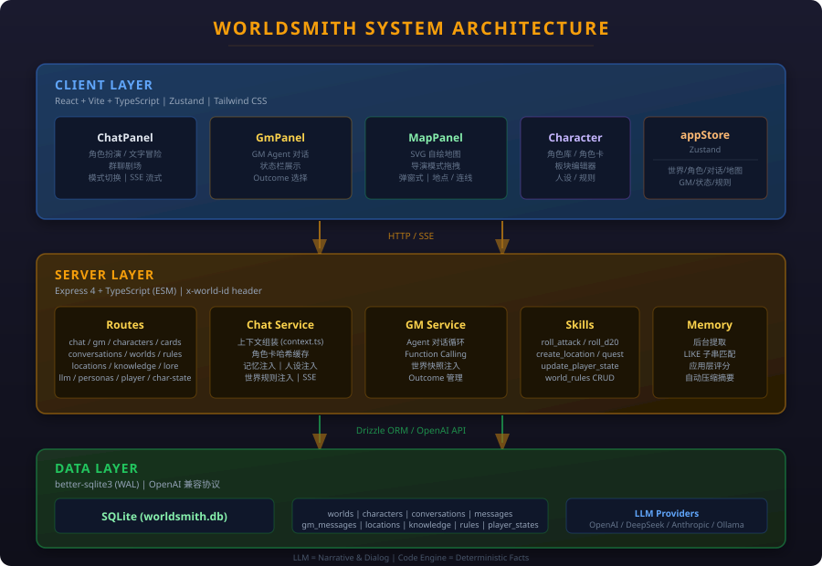
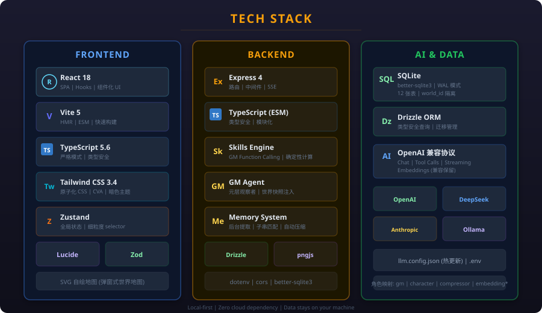
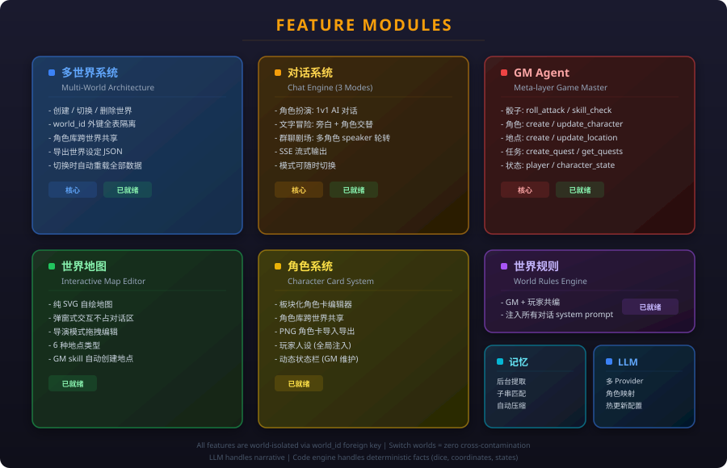

# Worldsmith

> 本地优先的 AI 角色扮演 + 开放世界 RPG 引擎 —— 由「代码引擎 + GM Agent」双轮驱动

Worldsmith 把传统跑团（TRPG）的世界设定、角色卡、骰子判定和 GM（Game Master）搬到了本地浏览器里：玩家与 AI 角色自由对话，GM Agent 作为元层观察者通过 Function Calling 调用确定性技能（掷骰、创建地点、更新状态栏），在保留 LLM 叙事张力的同时消除"AI 编造数值"的问题。

[]()
[]()
[]()
[]()
[]()
[]()
[]()
[]()
[]()
[]()
[]()

<details>
<summary>📊 支持的平台 / Provider</summary>

| 类别 | 选项 |
|------|------|
| **OS** | Windows / macOS / Linux |
| **LLM Provider** | OpenAI · DeepSeek · Anthropic · Ollama (本地) |
| **模型协议** | OpenAI 兼容 API |

</details>

---

## ✨ 核心亮点

- **多世界隔离架构** — 角色、对话、地图、记忆、GM 历史、世界规则全部按 `world_id` 外键隔离，切换世界零污染
- **GM Agent + Skills 工具调用** — GM 通过 `roll_attack` / `create_location` / `update_player_state` 等确定性函数操作世界，避免幻觉
- **三种对话模式可切换** — 角色扮演（1v1）、文字冒险（旁白+角色）、群聊剧场（多角色带 speaker 前缀）
- **世界规则注入** — GM 和玩家共同编写规则，自动注入所有对话与 GM 的 system prompt
- **多 Provider 热切换** — OpenAI / DeepSeek / Anthropic / Ollama 一键切换，角色级模型映射，配置文件热更新无需重启
- **板块化角色卡** — 可视化编辑器，自由组合"基础信息 / 外貌 / 性格 / 背景 / 关系"等板块，支持 PNG 角色卡导入 / 导出
- **世界地图编辑器** — 纯 SVG 自绘地图（弹窗式打开，不占对话区），支持缩放平移、导演模式拖拽，GM Agent 也可通过 skill 自动创建地点
- **动态状态栏** — 玩家状态与角色状态双轨管理，GM 可在剧情中实时更新 HP / 心情 / 好感度等
- **本地优先** — SQLite + 本地文件存储，数据完全在用户手中

---

## 🏗️ 架构总览

Worldsmith 采用分层架构设计，前端、后端、数据层清晰分离，确保系统的可维护性和扩展性。

### 系统架构图



**设计哲学**：LLM 负责叙事与对话，代码引擎负责确定性事实。骰子、坐标、状态栏数值一律由 Skills 计算，GM 只做"调用决策"和"叙事包装"，杜绝 AI 编造数值。

### 架构分层说明

| 层级 | 组件 | 职责 | 技术实现 |
|------|------|------|----------|
| **客户端层** | 浏览器界面 | 用户交互、UI展示、状态管理 | React + Vite + Tailwind + Zustand |
| **服务端层** | Express服务器 | 业务逻辑、API接口、GM Agent | Express 4 + TypeScript + SSE |
| **数据层** | 数据库与LLM | 数据持久化、AI模型调用 | SQLite + Drizzle ORM + OpenAI兼容协议 |

---

## 🛠️ 技术栈

Worldsmith 采用现代化全栈技术选型，确保开发效率和运行性能。

### 技术栈全景图



### 技术栈详细说明

| 层级 | 技术 | 说明 |
|------|------|------|
| **前端** | React 18 + Vite 5 + TypeScript | SPA，HMR 开发体验 |
| **样式** | Tailwind CSS + class-variance-authority | 暗色简约风，琥珀色主题 |
| **状态** | Zustand | 细粒度 selector，避免无效重渲染 |
| **图标** | lucide-react | 统一图标体系 |
| **后端** | Express 4 + TypeScript | ESM 模块 |
| **数据库** | better-sqlite3 + Drizzle ORM | 本地 SQLite，WAL 模式 |
| **LLM** | OpenAI 兼容协议 | 多 Provider 统一抽象 |
| **校验** | Zod | 运行时类型校验 |
| **共享** | workspace 包 `@worldsmith/shared` | 前后端共用类型定义 |

---

## 🎮 功能模块

Worldsmith 提供丰富的功能模块，支持完整的TRPG体验。

### 功能模块全景图



### 核心功能详解

#### 多世界系统

- 创建 / 重命名 / 删除世界（默认世界不可删除）
- 删除世界时可选择：保留角色（移入角色库）/ 导出世界设定为 JSON
- 所有业务表带 `world_id` 外键，`x-world-id` header 自动注入每个请求
- 角色库（`worldId = null`）跨世界共享，可导入到任意世界

#### 对话模式

| 模式 | 说明 | system prompt 组成 |
|------|------|-------------------|
| **角色扮演** | 1v1 与 AI 角色对话 | 世界规则 + 玩家人设 + 角色卡 + 记忆摘要 |
| **文字冒险** | 旁白+角色交替，第二人称 | + 场景设定 + 冒险模式指令 |
| **群聊剧场** | 多角色同台，带 `角色名:` 前缀 | + 全体成员角色卡 + speaker 轮转规则 |

模式可通过聊天面板右上角按钮随时切换，切换到群聊时弹出选角色对话框。

#### GM Agent

GM 是独立于角色对话的"元层观察者"，通过 Function Calling 调用 Skills：

- **确定性判定**：`roll_attack` / `roll_skill_check`（d20 + 加成 vs DC）
- **世界操作**：`create_character` / `update_character` / `create_location` / `update_location` / `create_connection`
- **任务系统**：`create_quest` / `get_quests`
- **玩家状态**：`update_player_state`（HP / 位置 / 时间 / 物品 / 金币）
- **角色动态状态**：`update_character_state`（心情 / 好感度 / 装备等，按角色隔离）
- **世界规则**：`create_world_rule` / `update_world_rule` / `delete_world_rule` / `get_world_rules`
- **状态查询**：`get_world_state` / `get_quests`

**上下文注入**：每次 GM 请求都会注入【世界规则】+【当前世界快照】（角色/地点/任务/玩家状态名单），GM 不得编造名单外的事物。

#### 世界规则

- GM 和玩家都可编写，按 `author` 字段区分（`gm` / `player`）
- 分类：`system` / `combat` / `magic` / `world` / `other`
- 启用的规则以 `【世界规则】` 块注入到**所有对话模式**和 **GM** 的 system prompt 最前
- 按世界隔离，切换世界自动重载

#### 世界地图

- 纯 SVG 自绘地图（已弃用 ReactFlow），支持滚轮缩放 / 拖拽平移 / 点选节点
- 弹窗式交互：顶部工具栏「地图」按钮打开，不占用对话区垂直空间
- 导演模式：直接拖拽节点编辑坐标，点击空白处取消选中
- GM skill `create_location` 可自动创建并连线到最近节点（黄金角散布算法）
- 6 种地点类型：城镇 / 森林 / 山脉 / 湖泊 / 地牢 / 其他

#### 状态栏系统

- **双轨管理**：玩家状态（`player_states`）+ 角色动态状态（`character_states`）按世界隔离
- **GM 维护**：GM 通过 `update_player_state` / `update_character_state` skill 在剧情中实时更新
- **自定义项**：管理弹窗按「玩家 / 角色」Tab 分页，可自定义键名 / 标签 / lucide 图标
- **上下文注入**：状态栏值随对话与 GM 请求注入，保证 AI 不编造状态数值

#### 记忆系统

- 对话达到阈值后后台触发记忆提取（不阻塞主流程）
- 提取的记忆写入 `knowledge_entries`，按 `scope`（world / character）和 `type` 分类
- 上下文组装时注入相关记忆摘要

---

## 📊 数据模型

核心表（均带 `world_id` 外键，按世界隔离）：

```
worlds
  ├── characters        (worldId 可空 = 角色库)
  ├── conversations     ├── group_members
  ├── messages
  ├── gm_messages       ├── gm_outcomes
  ├── locations         ├── location_connections
  ├── knowledge_entries (记忆 / 任务)
  ├── player_states     (玩家运行时状态)
  ├── character_states  (角色动态状态)
  ├── lore_entries      (世界书, 关键词触发)
  ├── user_personas     (全局, isActive 单选)
  └── world_rules       (author: gm | player)
```

数据库迁移由 Drizzle Kit 管理，迁移文件位于 `server/drizzle/`。

---

## 🚀 快速开始

### 环境要求

- **Node.js >= 18**（低于 18 会触发 better-sqlite3 原生模块错误）
- npm 或兼容包管理器

### 一键启动

```bash
# 克隆后直接运行（首次会自动 npm install）
npm start
```

脚本会自动完成：依赖检查 → 配置初始化 → 并行启动前后端 → 打开浏览器。

- 前端：http://localhost:5173
- 后端：http://localhost:3001

也可以使用平台脚本：

```bash
./start.sh      # macOS / Linux
start.bat       # Windows
```

### 配置 LLM

1. 复制 `server/.env` 并填入 API Key（参考 `.env.example`）：

```env
OPENAI_API_KEY=
DEEPSEEK_API_KEY=
ANTHROPIC_API_KEY=
```

2. 编辑 `server/llm.config.json`，设置 `activeProvider` 和 `roleMapping`：

```jsonc
{
  "activeProvider": "deepseek",
  "providers": [ /* ... */ ],
  "roleMapping": {
    "gm": "deepseek/deepseek-v4-flash",
    "character": "deepseek/deepseek-v4-flash",
    "compressor": "deepseek/deepseek-v4-flash"
  },
  "defaults": {
    "temperature": 0.7,
    "maxTokens": 2048,
    "streaming": true
  }
}
```

> **热更新**：修改 `llm.config.json` 后无需重启服务，下一轮对话自动生效。修改 `.env` 需重启。

---

## 📁 项目结构

```
worldsmith/
├── client/                     # 前端
│   └── src/
│       ├── components/         # UI 组件 (ChatPanel / GmPanel / MapPanel / ...)
│       │   └── ui/             # 基础组件 (Button / Dialog / Input / Toast)
│       ├── store/appStore.ts   # Zustand 全局状态
│       ├── lib/api.ts          # HTTP + SSE 客户端
│       └── App.tsx
├── server/                     # 后端
│   └── src/
│       ├── routes/             # Express 路由 (chat / gm / characters / ...)
│       ├── chat/               # 对话服务 + 上下文组装
│       ├── gm/                 # GM Agent 服务
│       ├── skills/             # GM 可调用的确定性函数
│       ├── llm/                # LLM 客户端 + 配置
│       ├── memory/             # 记忆提取
│       ├── db/                 # Drizzle schema + 连接
│       └── lib/                # 工具 (geo / http-error / world-context)
├── shared/                     # 前后端共享类型
├── scripts/start.mjs           # 跨平台一键启动
├── server/llm.config.json      # LLM 配置 (热更新)
└── server/.env                 # API Key (重启生效)
```

---

## 💻 开发命令

```bash
# 同时启动前后端开发模式（HMR）
npm run dev

# 类型检查
npm run typecheck

# 生产构建
npm run build

# 生成数据库迁移
cd server && npm run db:generate

# 执行数据库迁移
cd server && npm run db:migrate
```

---

## ⚙️ 配置说明

### `server/llm.config.json`

| 字段 | 说明 |
|------|------|
| `activeProvider` | 默认 Provider ID |
| `providers[]` | Provider 列表，`apiKey` 支持 `${env:XXX}` 引用环境变量 |
| `roleMapping` | 角色级模型映射：`gm` / `character` / `compressor` / `embedding`（embedding 为兼容保留，知识检索已改本地匹配） |
| `defaults` | 全局生成参数：`temperature` / `maxTokens` / `streaming` |

### `server/.env`

```
OPENAI_API_KEY=
DEEPSEEK_API_KEY=
ANTHROPIC_API_KEY=
```

---

## 🧠 设计决策

### 为什么用 Skills 而不是让 LLM 直接算？

LLM 的算术不可靠（`2d6+3` 可能算错），骰子随机性也无法验证。Skills 把"掷骰/坐标/状态更新"等确定性操作交给代码，GM 只决定"何时调用"和"如何叙事"，既保留了叙事自由度，又保证了数值可信。

### 为什么 GM 是世界级而不是对话级？

同一世界下的多个对话共享一个 GM 元对话流，GM 作为"世界观察者"不应该介入具体角色对话的实时内容。玩家想让 GM 针对当前场景回答时，可在提问中带上下文（如"刚才在酒馆里…"）。这种设计避免了 GM 上下文爆炸，也符合 TRPG 中 GM 的元层定位。

### 为什么不用向量检索？

早期版本用过 `text-embedding-3-small` 做语义检索，但引入了额外的 API 依赖和成本。当前改为 SQLite LIKE 子串匹配 + 应用层评分，对中小型数据集足够，消除了 embedding 模型依赖。

---

## 🗺️ 代码导航

核心模块与代码位置对照：

| 模块 | 代码位置 |
|---------|---------|
| GM Agent（元层观察者） | `server/src/gm/service.ts` |
| 确定性 Skills（骰子 / 地点 / 状态） | `server/src/skills/index.ts`（`roll_attack` / `create_location` / `update_player_state` 等） |
| LLM 客户端与多 Provider 热切换 | `server/src/llm/client.ts` · `server/src/llm/config.ts`（`llm.config.json` 热加载） |
| 多世界隔离（`world_id` 外键 + `x-world-id` 头） | `server/src/lib/world-context.ts` · `server/src/db/schema.ts` |
| 记忆提取与上下文注入 | `server/src/memory/extractor.ts` · `server/src/memory/service.ts` |
| 对话模式与世界规则注入 | `server/src/chat/context.ts` · `server/src/chat/service.ts` |
| 世界地图编辑器（含 GM 自动建点） | `client/src/components/MapPanel.tsx`，散布算法 `server/src/lib/geo.ts` |
| 双轨状态栏 | `server/src/routes/player-state.ts` · `server/src/routes/character-state.ts` |

---

## 🤝 贡献指南

欢迎贡献代码、提交 Issue 或建议新功能。请遵循以下流程：

### 开发环境准备

```bash
# 1. 克隆仓库
git clone <your-repo-url>
cd worldsmith

# 2. 安装依赖 (首次启动会自动安装, 也可手动执行)
npm install

# 3. 配置 LLM
cp .env.example server/.env
# 编辑 server/.env 填入 API Key
# 编辑 server/llm.config.json 设置 activeProvider

# 4. 启动开发服务器
npm run dev
```

### 代码规范

- **语言**：TypeScript 严格模式，所有新增代码必须通过 `npm run typecheck`
- **命名**：变量/函数用 camelCase，类型/接口用 PascalCase，常量用 UPPER_SNAKE_CASE
- **注释**：复杂逻辑需中文注释，公开 API 需 JSDoc
- **样式**：使用 Tailwind class，避免内联 style；新组件遵循 `ui/` 目录现有模式
- **状态**：通过 Zustand store 管理全局状态，避免 prop drilling
- **HTTP**：前端统一走 `lib/api.ts`，不直接使用 fetch
- **隔离**：所有业务 handler 必须通过 `worldIdFromArgs(args)` 获取 worldId，禁止跨世界查询

### 提交规范

使用 [Conventional Commits](https://www.conventionalcommits.org/) 格式：

```
<type>(<scope>): <subject>

type:   feat | fix | docs | style | refactor | perf | test | chore
scope:  client | server | shared | db | gm | skills | chat | 可选
subject: 简短描述 (中文/英文均可, 不超过 50 字)
```

示例：

```
feat(gm): 新增 create_world_rule skill 支持 GM 编写世界规则
fix(client): 修复世界切换后角色列表未清空的污染问题
perf(server): loadGroupCharacters 改用 inArray 消除 N+1 查询
docs: 补充 README 徽章和贡献指南
```

### 数据库变更

涉及 schema 变更时：

```bash
# 1. 修改 server/src/db/schema.ts
# 2. 生成迁移文件
cd server && npm run db:generate

# 3. 检查生成的 SQL 文件 (server/drizzle/XXXX_*.sql)
# 4. 执行迁移
npm run db:migrate

# 5. 同步更新 shared/src/index.ts 的类型定义
```

### PR 流程

1. 从 `main` 切出新分支：`feat/<短描述>` 或 `fix/<短描述>`
2. 确保 `npm run typecheck` 通过
3. 确保现有功能未被破坏（手动验证关键路径：世界切换 / 对话往返 / GM 调用）
4. PR 描述说明：改动目的 / 涉及模块 / 验证方式
5. 等待 review，根据反馈迭代

### Issue 指引

提交 Issue 时请包含：

- **环境**：OS / Node 版本 / 浏览器
- **复现步骤**：具体操作序列
- **预期 vs 实际**：期望发生什么，实际发生什么
- **日志**：客户端控制台 + 服务端终端的相关输出
- **世界上下文**（如相关）：哪个世界 / 哪个角色 / 哪种对话模式

### 改动边界提示

以下区域改动需格外谨慎，建议先开 Issue 讨论：

- `server/src/chat/context.ts` — 上下文组装顺序影响所有对话质量
- `server/src/gm/service.ts` — GM 系统提示词改动影响 Agent 行为
- `server/src/db/schema.ts` — schema 变更需配套迁移和数据兼容方案
- `server/llm.config.json` 结构 — 破坏性改动需前端 LLM 面板同步更新

---

## 📝 License

Private / Unlicensed